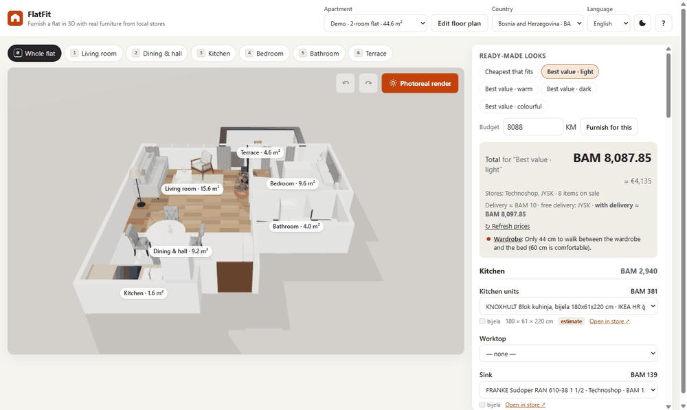
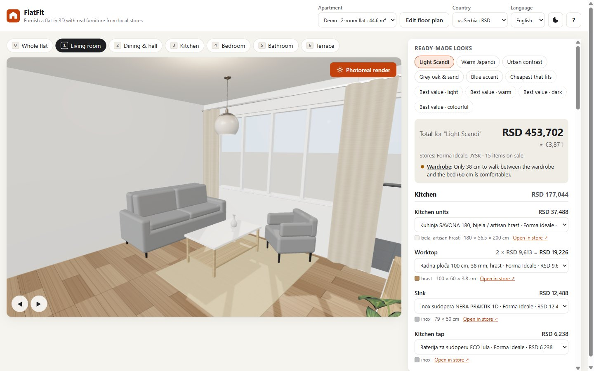
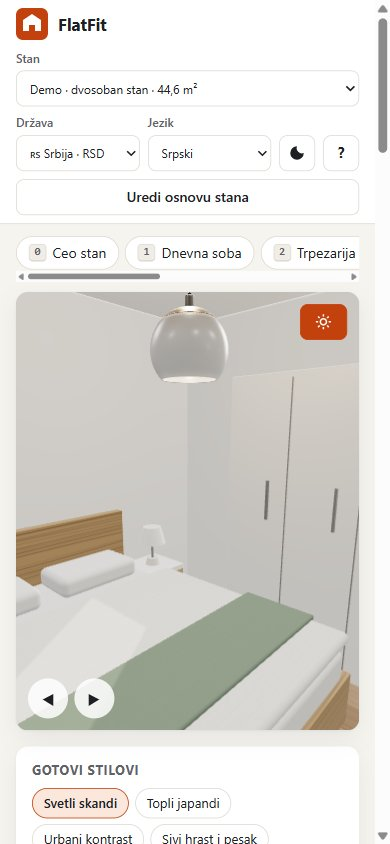
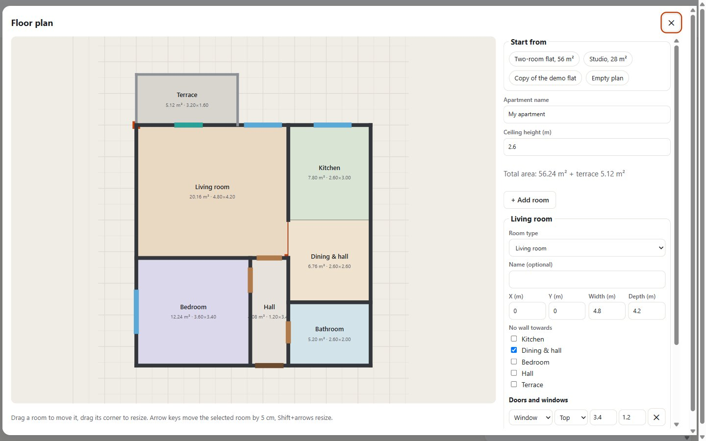
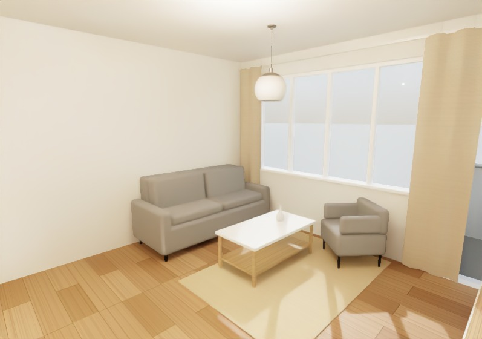
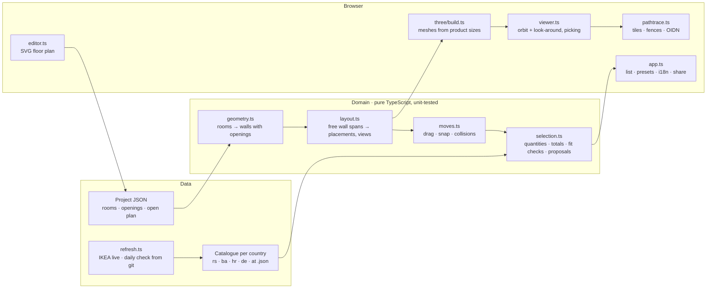

# FlatFit

**Furnish a flat in 3D with real furniture from local stores — prices by country, fit checks, and photoreal path-traced renders, all in the browser.**

[](https://github.com/aco993/flatfit/actions/workflows/ci.yml)
[](https://github.com/aco993/flatfit/actions/workflows/catalog.yml)
[](https://github.com/aco993/flatfit/actions/workflows/codeql.yml)
[](LICENSE)

**[Live demo](https://aco993.github.io/flatfit/)** · English · Deutsch · Srpski · Bosanski · Hrvatski · 🇷🇸 🇧🇦 🇭🇷 🇩🇪 🇦🇹



**[Read the case study](docs/case-study.md)** for the problems behind it: GPU driver resets, honest price data, testing with personas, performance. The main design decisions are written up as [architecture decision records](docs/adr/README.md).

### At a glance

| | |
|---|---|
| **Stack** | TypeScript (strict), three.js, three-gpu-pathtracer, Intel OIDN on WebGPU, Gemini or Claude API (vision + structured output, optional, the user's own key), Vite, Vitest, Playwright + axe-core, GitHub Actions, GitHub Pages |
| **Size** | ~8,000 lines of TypeScript (formatted by Biome), no UI framework ([why](docs/adr/0001-no-ui-framework.md)); domain logic has no DOM or three.js imports |
| **Data** | 5 markets, ~570 real products; every price re-checked daily by a GitHub Action and committed to git ([why](docs/adr/0002-static-site-git-scraped-prices.md)); IKEA prices checked live from the browser on request |
| **Quality** | Biome lint and format in CI, 170 unit tests, 45 end-to-end runs (12 persona journeys, 10 URL/device combinations in Chromium, Firefox and WebKit, a price-refresh test), accessibility scan, Lighthouse desktop 94–96 / mobile 68–70, CodeQL, Dependabot |
| **Hard parts** | GPU driver resets during path tracing, a cold-cache shader stall found with a CPU profile, collision checks on every pointer move, a budget solved as a multiple-choice knapsack, honest labelling of prices that cannot be checked automatically |

I built FlatFit while furnishing a small flat I rent out: I wanted to see what a cheap but nice setup looks like *with the actual products I can buy*, know the total before I go shopping, and be sure the sofa fits the wall. It grew into a general tool: draw any apartment, pick a country, and it proposes a furnished layout from that market's real catalogue.

## What it does

- **Any apartment.** Draw rooms on a grid (drag, resize, keyboard), add doors and windows, radiators and the TV socket, mark open-plan connections. Only have a picture of the plan, or a sketch? Load it, click the two ends of a wall whose length you know, then drag over it to draw rooms and click on walls to put doors and windows. Or let an AI read it: free with a Google Gemini key (daily quota), or with a paid Claude key (best with dimension lines). The picture goes from your browser straight to the service you chose, comes back as rooms, doors and windows laid over the picture, and you correct what it got wrong. When the free quota runs out, the app says so and what a paid key would take ([how](docs/adr/0005-reading-plans-with-claude-from-the-browser.md)). Walls, floors and camera views are derived from the plan. A real two-room flat (44.6 m²) ships as the demo.
- **Real products, by country.** Serbia (Forma Ideale, JYSK, IKEA, XXXLesnina, mömax, Emmezeta, Gigatron — 145 products), Bosnia and Herzegovina (JYSK, Technoshop, prices in KM — 97), Croatia, Germany and Austria (IKEA, ~110 each). Every 3D piece is built from the chosen product's width, depth, height and colour, and links to the store page. Dining chairs, armchairs, round coffee tables, TV benches and nightstands use CC0 models from Poly Haven, stretched to the product's exact size and repainted in its colour on a canvas (so the path tracer sees the same colour); sofas, beds and wardrobes stay procedural, because no modern CC0 model exists and a period piece would misrepresent what the store sells.
- **Prices that keep up with sales.** *Refresh prices* checks every IKEA price live from your browser, including when a sale ends, and takes the other stores from the daily check that a GitHub Action commits to this repository. Where no local store sells online with sizes (kitchen units in Bosnia), the price is an estimate from a neighbouring market and labelled as one.
- **Automatic layout.** A rule-based planner finds free wall stretches (doors and their swing, windows and radiators for tall items), puts the TV by its socket and the sofa opposite it, the bed against the best wall with bedside tables, the wardrobe where it does not block the bed, the kitchen run with the fridge in the niche, the table where people can sit.
- **Move things yourself.** Select a piece and drag it in the 3D view: it snaps to a 5 cm grid, turns its back to a wall when you bring it close, and its frame turns red while it would hit another piece, a wall or a door's swing. `T` turns it, Shift + arrows nudge it, and every change can be undone (Ctrl+Z / Ctrl+Y).
- **Fit checks with numbers.** “Kitchen and fridge need 245 cm, the wall has 248 cm”, “only 38 cm between wardrobe and bed”. Overruns up to 10 cm are “measure first”, more is “does not fit”.
- **Quantities and totals that match a real shopping trip.** Curtains per window (pairs count as one pack), worktop pieces to cover the kitchen length, two narrow slatted bases for a 160 cm bed, chairs only if the table set has none. Expired promotions fall back to the regular price.
- **Looks and proposals.** Hand-picked looks for Serbia plus generated ones for every market (*cheapest that fits*, *best value light / warm / dark / colourful*), scored by price, colour family and fit.
- **Photoreal render.** One click path-traces the current view on the GPU (three-gpu-pathtracer) and denoises it with Intel Open Image Denoise running as a neural network on WebGPU. Built to survive weak hardware (below).
- **A budget.** Type an amount and the planner spends it where it shows: a multiple-choice knapsack over the catalogue (dynamic programming, value = typical price × log of what a slot costs), then the real total and the fit checks are recomputed. 9,000 KM for the demo flat adds a TV, an armchair, lamps and a bed with storage, and stays under the amount.
- **Delivery, store by store.** Each store's published home-delivery terms (tiers by order value, free-delivery thresholds, per-appliance fees) give the total with delivery; stores that only show the price in the basket are named instead of guessed.
- **A measuring sheet.** No exact measurements yet? Print the floor plan with every wall, door, window, radiator and socket numbered, and a table with the value in the plan and an empty column for what you measure.
- **A listing sheet.** One click photographs the furnished rooms from the 3D view (or uses the last photoreal render), and lays them out with the floor plan, the areas, an editable title and description, and what the flat is furnished with (prices on request). The browser's print dialog saves it as a PDF for a rental or sales listing.
- **Share and export.** A link restores the country, language, flat, every chosen product and where you moved things; custom floor plans travel inside the link. Shopping list as CSV; print view.
- **Accessible and responsive.** Keyboard shortcuts for everything, skip link, live regions, focus management in dialogs, reduced-motion support, light/dark theme, phone/tablet/desktop layouts.

| Desktop | Phone | Floor-plan editor | Photoreal render |
|---|---|---|---|
|  |  |  |  |

## Path tracing that does not crash laptops

The first version froze or showed a black image on an Intel UHD laptop. The causes, and what the render pipeline does now:

1. **GPU driver resets (Windows TDR).** If one submission keeps the GPU busy for ~2 s, Windows resets the driver and the canvas goes black. FlatFit splits each pass into tiles and only queues the next tile when a `WebGLSync` fence reports the previous one finished, so work never piles up. Tile count adapts to the measured time per tile.
2. **Recovering anyway.** A lost context or an all-black frame is detected; the renderer starts over on a fresh canvas with smaller tiles (up to two retries) and tells the user.
3. **Quality by hardware.** The GPU name picks *fast* (16 passes, 640 px) for integrated/mobile GPUs, *balanced* or *high* (128 passes, 1440 px) for discrete ones; the user can override.
4. **Always in control.** *Finish now* denoises what is done; *Cancel* or **Esc** stops at any phase. First-time shader compilation (1–3 min on Windows/ANGLE) shows a live timer instead of looking frozen.
5. **Few samples, clean image.** Intel OIDN with albedo and normal guide buffers (rendered by the raster pipeline from the same camera) makes 16–40 passes look clean; without WebGPU a bilateral filter with outlier removal is used.

## Performance

Lighthouse on a laptop with Intel UHD graphics (real GPU, fresh browser profile, production build):

| | Before | After |
|---|---|---|
| Performance, desktop | 32 | **94–96** |
| Performance, mobile (4× CPU throttling) | 15 | **68–70** |
| Total blocking time, desktop · mobile | 2,440 ms · 9,160 ms | **160 ms · 1,600 ms** |
| Layout shift (CLS), desktop | 0.89 | **0.05** |
| Accessibility · best practices · SEO | 100 · 100 · 91 | **100 · 100 · 100** |

What moved the numbers: space reserved for UI that fills in late, one scene build at startup instead of three, a geometry cache shared between builds, and above all **compiling shaders in parallel** (`KHR_parallel_shader_compile`) before the first frame. A CPU profile found the last 3-second freeze on a cold Windows shader cache: three's PMREM environment baking compiled its GGX filter twice, because the warm-up mesh had no position attribute and so compiled a different shader variant. A second round on the throttled mobile profile took blocking time from 9.2 s to 1.6 s: the flat is drawn without per-frame frustum culling (it tested every mesh's bounding sphere on every frame), the shadow map is redrawn only when furniture changes, room labels use the size kept by a ResizeObserver instead of forcing a layout every frame, and the 3 MB of decorative models load on the first interaction or when the page is idle, with textures at 512 px. Reserving the scrollbar gutter removed the last layout shift. Details in the [case study](docs/case-study.md).

## Architecture



- `src/domain` has no DOM or three.js imports, so the planner, fit checks and pricing run in Node tests.
- `src/ui/app.ts` holds the state and the glue; the list, product card, keyboard shortcuts, flats, price refresh, share links and undo history are separate modules (`list`, `card`, `keyboard`, `projects`, `prices`, `share`, `history`).
- Products are referenced by stable ids; share links store `{slot: id}` compressed with lz-string.
- Everything is static: the site is a Vite build on GitHub Pages; plans and choices stay in the visitor's browser (`localStorage`).

## Catalogue pipeline

| Script | What it does | When |
|---|---|---|
| `scripts/prices.mjs rs\|ba\|hr\|de\|at` | Re-checks every price on the store's own page: IKEA's search endpoint (current price, previous price, when the sale ends), schema.org offers (JYSK, Gigatron), shop data (Forma Ideale, Technoshop, Emmezeta). Prices only, so product ids and saved choices stay valid. | Daily, GitHub Action |
| `scripts/ikea-catalog.mjs de\|at\|hr [slots]` | Rebuilds an IKEA market: price, measurements tab (W/D/H, diameter, length), colour, flags such as *bed frame without slatted base* or *curtains sold in pairs*. Search phrases and measurement names per language. | Mondays |
| `scripts/ba-catalog.mjs` | Builds Bosnia and Herzegovina from JYSK BiH category pages (schema.org item lists), Technoshop product pages, and IKEA Croatia estimates converted to KM. | By hand |

The Action runs the unit tests on the new data (schema, sizes, sale dates, links, presets) and commits it to `main` only if they pass, then redeploys. Stores that answer with a bot challenge (XXXLesnina, mömax) are skipped rather than worked around, and the app labels their prices as checked by hand with the date.

Adding a country: a catalogue JSON in `src/data/catalogs/`, an entry in `src/data/countries.ts`, a name in `src/i18n.ts`, and a line in `.github/workflows/catalog.yml`.

## Tests

| Layer | Tool | What |
|---|---|---|
| Unit (170) | Vitest | wall derivation, demo areas, quantities, promotions, dependencies, fit checks, layout inside rooms, generated proposals fit for 5 markets × 3 flats, moving pieces (rigid groups, snapping, turning, collisions with furniture, walls, doors and radiators), TV socket and radiators in the planner, share links, catalogue schema, sale dates and estimates, live price refresh (stubbed network), budget solver, delivery rules, measuring sheet, translation key parity and an ijekavian check for Bosnian and Croatian, share links, undo history, the listing sheet, and reading a plan picture (cleaning the AI's answer, lining up walls, placing the picture, both providers' requests, answers and errors such as a used-up free quota) |
| End to end | Playwright | persona journeys and a URL matrix, see below |
| Accessibility | axe-core | WCAG 2 A/AA, no serious or critical violations |

Personas (`tests/e2e/personas.spec.ts`):

- **Ana**, renting out a flat in Novi Sad, on her phone in Serbian: picks the cheapest look, checks the total drops, opens a product card and its store link, and the page never scrolls sideways.
- **Jonas** in Berlin, desktop, German: switches to Germany, verifies every link goes to IKEA Germany, swaps the sofa, shares the link and opens it in a new tab with the same total.
- **Mira**, keyboard and screen reader only: skip link, view shortcuts, help dialog, language cycling, axe scan.
- **Luka**, a landlord: draws a studio from a template, adds a bedroom with the keyboard, saves, reloads, exports JSON, deletes.
- **Nina**, only a picture of her plan: loads it, sets the scale from the 8 m dimension line, draws the living room to it, saves; the picture never goes into share links.
- **Dario**, has a picture of a plan and his own Claude API key: lets Claude read it (the API is stubbed; the test checks the request), gets two rooms over the picture, draws a third by dragging, clicks a window onto its wall, saves.
- **Lea**, wants it free: reads the plan with a Google AI Studio key (stubbed), sees the free-tier privacy note first, and when the quota runs out is told a paid key is needed while her rooms stay.
- **Sara**, rearranging: selects the sofa, drags it with the mouse into the coffee table, sees the warning, turns it with `T`, undoes everything with the button and Ctrl+Z, redoes with Ctrl+Y.
- **Petra**, old laptop: starts a photoreal render, cancels it mid-way, the page stays usable.
- **Emir** in Sarajevo, in Bosnian, 9,000 KM to spend: sets the budget, checks the total stays under it with nothing that does not fit, sees delivery store by store, and opens the measuring sheet.
- **Marko**, renting the flat out: makes a listing sheet and checks it has photos of the rooms, the plan, the areas and the furniture, an editable title, prices only when he asks, and the 3D view left as it was.

URL matrix (`tests/e2e/matrix.spec.ts`), in Chromium, Firefox and WebKit: every market and all five languages, Bosnia on a phone, Croatia in dark mode, a link with moved furniture, a link carrying a whole floor plan, and a deliberately broken link. Each must load without console errors, show the total in the right currency and never scroll sideways. A separate test stubs IKEA's endpoint and checks that *Refresh prices* applies a new sale and remembers it after a reload.

CI (`.github/workflows/ci.yml`): lint (Biome) → typecheck → unit tests → build → Playwright (Chromium, Firefox, WebKit) → deploy to GitHub Pages on `main`. CodeQL scans the code weekly and on every pull request; Dependabot proposes dependency updates monthly.

## Run it

```bash
npm install
npm run dev          # http://localhost:5173
npm test             # unit tests
npm run lint         # Biome lint + format check (npm run format fixes)
npm run build && npx playwright test
```

## Keyboard

`0–9` camera views · arrows look around · `+`/`−` zoom · `T` turn the selected piece · Shift + arrows nudge it · Ctrl+Z / Ctrl+Y undo/redo · `R` photoreal render · `E` floor plan · `L` language · `Esc` close/cancel · `?` help

## Limits

- Room shapes are rectangles (L-shapes are built from several rooms with open connections).
- Reading a plan needs your own key: Gemini is free up to a daily quota (and on the free tier Google may use what is sent), Claude is paid (a few cents per plan). Either way it is a first draft: check the rooms against the picture before saving.
- The planner is rule-based; it proposes, you drag things where you want them. Fit checks use the plan, not a laser measure.
- Prices are at most a day old (IKEA: live on *Refresh prices*); stores behind a bot challenge are checked by hand, and the app shows the date.
- The interface is in English, German, Serbian, Bosnian and Croatian. Croatian is a layer over Bosnian with only the words that differ (hladnjak, kupaonica, tlocrt), and a unit test fails if an ekavian word slips into either.

Tried it on your flat? [Send feedback](https://github.com/aco993/flatfit/issues/new?template=feedback.yml) — what was unclear or missing helps most.

MIT licensed. Third-party assets: see [THIRD_PARTY.md](THIRD_PARTY.md).
