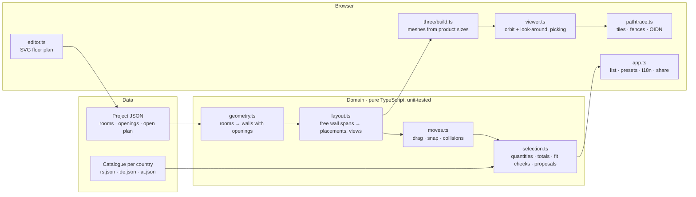

# FlatFit

**Furnish a flat in 3D with real furniture from local stores — prices by country, fit checks, and photoreal path-traced renders, all in the browser.**

[](https://github.com/aco993/flatfit/actions/workflows/ci.yml)
· **[Live demo](https://aco993.github.io/flatfit/)** · English · Deutsch · Srpski


I built FlatFit while furnishing a small flat I rent out: I wanted to see what a cheap but nice setup looks like *with the actual products I can buy*, know the total before I go shopping, and be sure the sofa fits the wall. It grew into a general tool: draw any apartment, pick a country, and it proposes a furnished layout from that market's real catalogue.

## What it does

- **Any apartment.** Draw rooms on a grid (drag, resize, keyboard), add doors and windows, mark open-plan connections. Walls, floors and camera views are derived from the plan. A real two-room flat (44.6 m²) ships as the demo.
- **Real products, by country.** Serbia (Forma Ideale, JYSK, IKEA, XXXLesnina, mömax, Emmezeta, Gigatron — 145 products), Germany and Austria (IKEA, ~110 each). Every 3D piece is built from the chosen product's width, depth, height and colour, and links to the store page.
- **Automatic layout.** A rule-based planner finds free wall stretches (doors and their swing, windows for tall items), puts the sofa opposite the TV, the bed against the best wall with bedside tables, the wardrobe where it does not block the bed, the kitchen run with the fridge in the niche, the table where people can sit.
- **Move things yourself.** Select a piece and drag it in the 3D view: it snaps to a 5 cm grid, turns its back to a wall when you bring it close, and its frame turns red while it would hit another piece, a wall or a door's swing. `T` turns it, Shift + arrows nudge it, and every change can be undone (Ctrl+Z / Ctrl+Y).
- **Fit checks with numbers.** “Kitchen and fridge need 245 cm, the wall has 248 cm”, “only 38 cm between wardrobe and bed”. Overruns up to 10 cm are “measure first”, more is “does not fit”.
- **Quantities and totals that match a real shopping trip.** Curtains per window (pairs count as one pack), worktop pieces to cover the kitchen length, two narrow slatted bases for a 160 cm bed, chairs only if the table set has none. Expired promotions fall back to the regular price.
- **Looks and proposals.** Hand-picked looks for Serbia plus generated ones for every market (*cheapest that fits*, *best value light / warm / dark / colourful*), scored by price, colour family and fit.
- **Photoreal render.** One click path-traces the current view on the GPU (three-gpu-pathtracer) and denoises it with Intel Open Image Denoise running as a neural network on WebGPU. Built to survive weak hardware (below).
- **Share and export.** A link restores the country, language, flat, every chosen product and where you moved things; custom floor plans travel inside the link. Shopping list as CSV; print view.
- **Accessible and responsive.** Keyboard shortcuts for everything, skip link, live regions, focus management in dialogs, reduced-motion support, light/dark theme, phone/tablet/desktop layouts.

| Desktop | Phone | Floor-plan editor | Photoreal render |
|---|---|---|---|
|  |  |  |  |

## Path tracing that does not crash laptops

The first version froze or showed a black image on an Intel UHD laptop. The causes, and what the render pipeline does now:

1. **GPU driver resets (Windows TDR).** If one submission keeps the GPU busy for ~2 s, Windows resets the driver and the canvas goes black. FlatFit splits each pass into tiles and only queues the next tile when a `WebGLSync` fence reports the previous one finished, so work never piles up. Tile count adapts to the measured time per tile.
2. **Recovering anyway.** A lost context or an all-black frame is detected; the renderer starts over on a fresh canvas with smaller tiles (up to two retries) and tells the user.
3. **Quality by hardware.** The GPU name picks *fast* (16 passes, 640 px) for integrated/mobile GPUs, *balanced* or *high* (128 passes, 1440 px) for discrete ones; the user can override.
4. **Always in control.** *Finish now* denoises what is done; *Cancel* or **Esc** stops at any phase. First-time shader compilation (1–3 min on Windows/ANGLE) shows a live timer instead of looking frozen.
5. **Few samples, clean image.** Intel OIDN with albedo and normal guide buffers (rendered by the raster pipeline from the same camera) makes 16–40 passes look clean; without WebGPU a bilateral filter with outlier removal is used.

## Architecture



- `src/domain` has no DOM or three.js imports, so the planner, fit checks and pricing run in Node tests.
- Products are referenced by stable ids; share links store `{slot: id}` compressed with lz-string.
- Everything is static: the site is a Vite build on GitHub Pages; plans and choices stay in the visitor's browser (`localStorage`).

## Catalogue pipeline

`scripts/ikea-catalog.mjs de|at [slots]` rebuilds a market from IKEA's public search endpoint and product pages: price, previous price, measurements tab (W/D/H, diameter, length), colour, and flags such as *bed frame without slatted base* or *curtains sold in pairs*. A weekly GitHub Action runs it, runs the unit tests against the new data (schema, links, sizes, presets) and opens a pull request. The Serbian catalogue was assembled by hand; `scripts/rs-prices.mjs` re-checks every price on the store's own page each week (IKEA's search endpoint, schema.org offers and shop data for JYSK, Forma Ideale, Gigatron, Emmezeta) and records the date each price was confirmed. Stores that answer with a bot challenge are skipped rather than worked around, and the app labels their prices as checked by hand with the date.

Adding a country: a catalogue JSON in `src/data/catalogs/`, an entry in `src/data/countries.ts`, a name in `src/i18n.ts`.

## Tests

| Layer | Tool | What |
|---|---|---|
| Unit (69) | Vitest | wall derivation, demo areas, quantities, promotions, dependencies, fit checks, layout inside rooms, generated proposals fit for 3 markets × 3 flats, moving pieces (rigid groups, snapping, turning, collisions with furniture, walls and doors), share links, catalogue schema and price dates, translation key parity |
| End to end | Playwright | persona journeys, see below |
| Accessibility | axe-core | WCAG 2 A/AA, no serious or critical violations |

Personas (`tests/e2e/personas.spec.ts`):

- **Ana**, renting out a flat in Novi Sad, on her phone in Serbian: picks the cheapest look, checks the total drops, opens a product card and its store link, and the page never scrolls sideways.
- **Jonas** in Berlin, desktop, German: switches to Germany, verifies every link goes to IKEA Germany, swaps the sofa, shares the link and opens it in a new tab with the same total.
- **Mira**, keyboard and screen reader only: skip link, view shortcuts, help dialog, language cycling, axe scan.
- **Luka**, a landlord: draws a studio from a template, adds a bedroom with the keyboard, saves, reloads, exports JSON, deletes.
- **Sara**, rearranging: selects the sofa, drags it with the mouse into the coffee table, sees the warning, turns it with `T`, undoes everything with the button and Ctrl+Z, redoes with Ctrl+Y.
- **Petra**, old laptop: starts a photoreal render, cancels it mid-way, the page stays usable.

CI (`.github/workflows/ci.yml`): typecheck → unit tests → build → Playwright on Chromium → deploy to GitHub Pages on `main`.

## Run it

```bash
npm install
npm run dev          # http://localhost:5173
npm test             # unit tests
npm run build && npx playwright test
```

## Keyboard

`0–9` camera views · arrows look around · `+`/`−` zoom · `T` turn the selected piece · Shift + arrows nudge it · Ctrl+Z / Ctrl+Y undo/redo · `R` photoreal render · `E` floor plan · `L` language · `Esc` close/cancel · `?` help

## Limits

- Room shapes are rectangles (L-shapes are built from several rooms with open connections).
- The planner is rule-based; it proposes, you drag things where you want them. Fit checks use the plan, not a laser measure.
- Catalogue prices are a snapshot; the date is shown in the app and the weekly job keeps DE/AT fresh.

MIT licensed. Third-party assets: see [THIRD_PARTY.md](THIRD_PARTY.md).
